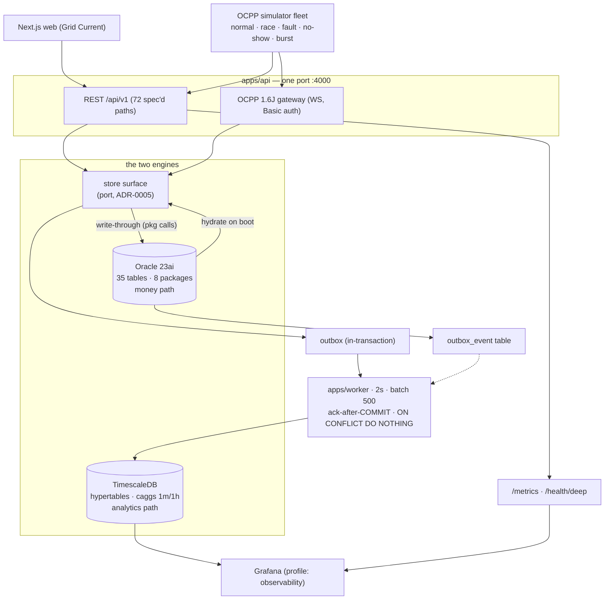
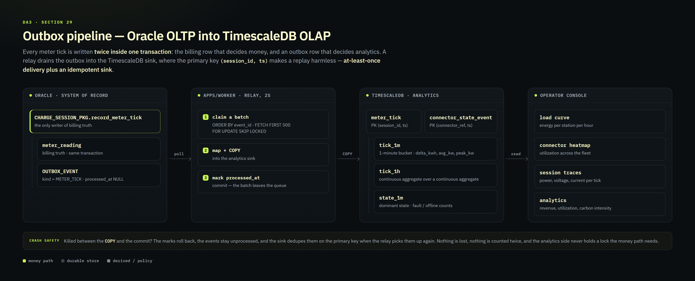
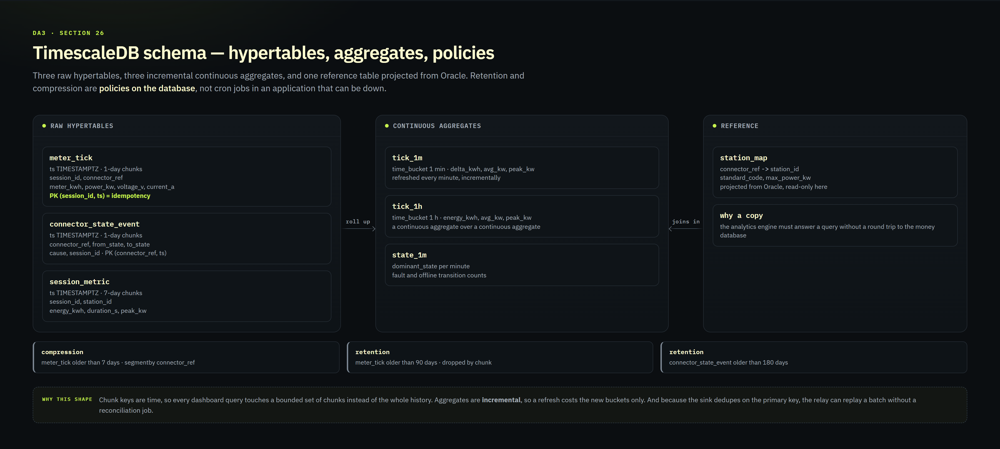
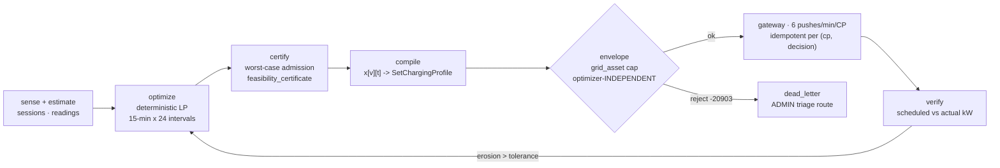

# VoltHub CSMS — Architecture (1 page)

## The shape

A **modular monolith + one worker** (ADR-0001). Express API and the OCPP WebSocket gateway share one port; a 2-second relay worker moves telemetry events from the OLTP engine to the time-series engine. No microservices, no brokers, no cache tier — every simplification is a documented decision, not an omission.

## The three seams that hold it together

1. **Store port (ADR-0005):** every route is written against `createStore()`'s method surface. `store.js` is the documented local test double; `db/oracle.js` wraps the same object with write-through PL/SQL package calls. Tests run hermetic locally and against real Oracle in CI (`STORE=oracle`).
2. **Outbox pipeline (ADR-0003):** `meter_reading` + `outbox_event` commit atomically inside one package call; the relay delivers at-least-once and the sink dedupes (idempotent replay), so billing never depends on TimescaleDB being up.
3. **Error-band contract (`src/errors.js`):** `ORA-20501…209xx` → HTTP `422/409/402/…` mapped once; identical bands raised by `RAISE_APPLICATION_ERROR` in PL/SQL and mirrored in JS.

Rendered from `diagrams/da3.html` by `node scripts/render-da3.mjs`; the portable Mermaid
equivalents are `diagrams/da3-pipeline.mmd` and `da3-schema.mmd`. Both diagrams are also
available as a two-page vector PDF — [`diagrams/out/da3.pdf`](diagrams/out/da3.pdf) — for
handouts and print.

## Key decisions (ADR index)

| ADR  | Decision                       | One-line reason                                                                            |
| ---- | ------------------------------ | ------------------------------------------------------------------------------------------ |
| 0001 | Modular monolith               | Money invariants stay in one transaction boundary; sagas would hide the graded correctness |
| 0002 | TimescaleDB for telemetry      | Ticks are append-heavy/immutable/window-read; matrix score 4.90 vs InfluxDB 3.95           |
| 0003 | Outbox + relay                 | Atomic-with-write publication; dual-write diverges on crash; CDC too heavy for scope       |
| 0004 | Plain JS + Express             | Zero-build velocity; contracts carried by OpenAPI drift gate + tests, not types            |
| 0005 | Hexagonal store                | Replacement, not rewrite: routes unchanged between engines; hermetic tests preserved       |
| 0014 | Control-loop closure           | A loop whose certify/verify stages are test-only is a diagram, not a mechanism             |
| 0006 | Connector FK-native            | Display handles (`cp_id:connector_no`) stop being the only truth; joins stop being LIKE    |
| 0007 | OCPP remote commands           | CSMS→CP calls share one registry + uid plumbing instead of three ad-hoc senders            |
| 0008 | AI as advisory sidecar         | A model between a driver and a breaker is unauditable; deterministic LP owns constraints   |
| 0009 | Multi-tenancy (deferred)       | Retrofitting tenancy is rewrite-grade; designed in ADR-0009, started only with a tenant    |
| 0010 | FC-HCC control loop            | Sensing without actuation makes every smart-charging claim unfalsifiable                   |
| 0011 | Control-path integrity         | The envelope must not consult the optimizer it constrains (failure independence)           |
| 0012 | Twin profile compliance        | A twin that always obeys validates nothing; it must honor — or honestly ignore — profiles  |
| 0013 | Benchmark methodology          | A methodology decided after results exist is not a methodology                             |
| 0015 | Acceptance-envelope scheduling | Feasibility first, price second; repair the taper-binding family without editing E3        |
| 0016 | Wallet signature rail          | The authorisation and the settlement must not be the same act                              |
| 0017 | Carbon-aware charging          | Average intensity accounts, marginal intensity schedules; carbon never blocks a session    |
| 0018 | OCPP management commands       | Day-2 operations need the charger's answer, not a fire-and-forget 202                      |

## The control path (the part that acts)

Per-site mode is `OFF | ADVISORY | ENFORCED`, default **OFF** — actuation is opt-in per
site, and `ENFORCED` requires an ACTIVE SITE grid asset (an envelope without a certified
cap is a hope).

Certification runs **before** scheduling and is graded **after** it: the promise is a
persisted row, the plan must honour its floor, the acks are correlated, and metered kW
is compared against the schedule in force. Where the promise was not kept — target SoC
above the CC-CV knee, where the allocator planned energy the battery could not absorb —
the benchmark said so (ADR-0014, `docs/perf.md`), and **ADR-0015 fixes it**: the allocator
now consumes the same acceptance curve as the certifier and the twin (`acceptanceFactor`,
one definition, three consumers), so plan-time and realised feasibility cannot disagree.
Measured in E6: shortfall 42.6% → 2.36%, deadline miss 56.6% → 15.7%, plan-honesty gap
1,280 kWh → 0.011 kWh, and **bit-identical schedules below the knee** (H0).

## Advisory planes (they observe; they do not own the money path)

Two sidecars are deliberately outside the control transaction boundary:

- **AI (ADR-0008)** — pooled 87-station panel from three public datasets; forecast, anomaly
  scan, optimizer, model card, occlusion explanation and PSI/KS drift. Every response is
  `advisory: true`, RBAC/scope-checked and audited. It can rank options; it cannot write a
  ledger row, set a tariff or actuate a breaker.
- **CarbonPilot (ADR-0017)** — deterministic `model-v1` intensity, per-session receipts with
  a SHA-256 over the accounting payload, and a carbon price that enters scheduling at weight
  **0** unless an operator enables it. Average intensity is used for accounting, marginal
  for scheduling; unknown grids fall back to `GLOBAL`, not a flattering low-carbon guess.

A carbon-aware plan still travels through `POST /control/plan` and the ADR-0015 envelope:
carbon changes the **ranking** of hours, never the admission or actuation rules.

## OCPP day-2 operations

The gateway's CSMS→CP surface is a closed, allow-listed catalog (ADR-0018): the two remote
start/stop calls from ADR-0007 plus ten management commands (`Reset`, `UnlockConnector`,
`ChangeAvailability`, `Get/ChangeConfiguration`, `TriggerMessage`, `ReserveNow`,
`CancelReservation`, `ClearCache`, `DataTransfer`). Each command awaits the `CALLRESULT`,
maps the charger's status to an HTTP outcome, is admin-only and is audited. Full matrix and
explicit gaps: [`docs/ocpp-1.6-conformance.md`](docs/ocpp-1.6-conformance.md).

## Where it deliberately stops (scale exits, not features)

- Multi-VM ⇒ the Maps read-cache becomes read-through (and Redis becomes justified).
- > 50 charge points/VM ⇒ shard the OCPP gateway by identity hash.
- Any of these is measurable first (`bench/`), decided second.
